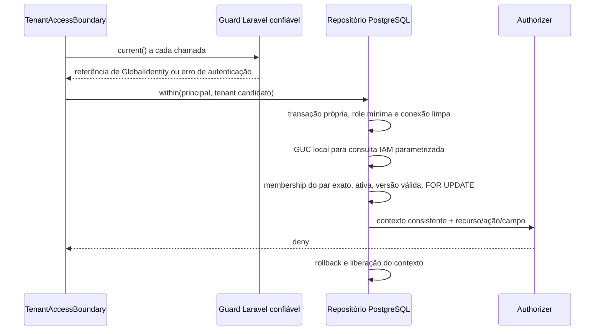

# F1-02 — fronteira de identidade, membership e tenant

Data: 04/11/2026. Incremento experimental da Issue #3, derivado de
`dev/fast-track-crm-2026-11-04` em `bd8326fe003a4daee467e832b408408184fd5840`.
Referência: [PR #2](https://github.com/rafhael100/imagine-crm/pull/2).
Somente desenvolvimento/CI sintética; sem homologação ou liberação de produção.

## Fontes e conciliação

Foram consultados AGENTS.md, F0-02/03/04, F1-01, CORE01-D04..D07,
CORE02-D05, CORE03/04/07/09, DEV-GATE-00 e IN-168 (SEG-01/02).
A autorização [DEC-FASTTRACK-01](https://github.com/rafhael100/imagine-crm/blob/main/docs/planejamento/CRM-DEC-FASTTRACK-autorizacao-desenvolvimento-controlado-2026-11-04.md)
está na main documental, ausente desta base; referências relativas antigas para ela não resolvem nesta branch.
O pedido explícito da Issue #3 e desta implementação autoriza este recorte isolado.

A main documental também contém CT-F1-01 e a decisão técnica delegada
CORE02-D05 P1+P2 escopada posteriores ao acervo da base. Essa diretriz é
preservada como referência documental, sem criar política executável neste
incremento: a Issue #3 exige conservar `DenyByDefaultAuthorizer`. Não há
catálogo aprovado implementado, grants, MFA, entitlement ou papéis presumidos.
Os 67 IDs CORE e gates SEG/INT/ARQ/FIN/CON permanecem abertos.

## Contratos mínimos e decisão experimental

- `GuardPrincipalSource` recebe um guard de infraestrutura. Usa exclusivamente
  `guard->user()`, exige o mapeamento explícito `GlobalIdentity` e UUID. Não
  aceita principal de header/body, resolver de Request, e-mail ou CNPJ.
- `GlobalIdentity` mapeia o catálogo global experimental. A configuração do
  provider `web` ainda aponta ao `User` do scaffold, que é recusado. Não há
  cadastro, login, MFA ou autenticação funcional habilitados. Integração de
  provider/sessão real depende de CORE04/SEG e revisão posterior; nos testes
  apenas o guard sintético entrega essa identidade. Criar esse objeto por si
  só não autentica: ele somente é consumido quando entregue pelo guard confiável.
- `ActiveMembershipStore` é porta de repositório confiável, sem snapshot de
  entrada. O adaptador PostgreSQL consulta o vínculo por identidade×organização
  em cada unidade. Somente `active` e versão positiva são aceitos; ausente,
  suspended, disabled ou estado desconhecido negam sem enumerar registros.
- O tenant é candidato, nunca prova de autorização. A única consulta antes
  da validação é a consulta IAM do par exato. Como o schema F1-01 protege
  membership por RLS tenant-bound, o marcador candidato é atribuído
  exclusivamente dentro desta transação para essa consulta. Nenhum callback
  de negócio é alcançado antes de validar o vínculo e consultar o autorizador.
- A operação permanece na mesma transação. `FOR UPDATE` serializa alteração
  do vínculo com a unidade corrente; revogação já confirmada será observada
  pela próxima unidade. Não promete revogação retroativa, cancelamento de
  efeito concluído ou invalidação distribuída de sessão/worker/cache.
- O adaptador recusa SQLite, transação externa/aninhada, marcador residual,
  role SUPERUSER/BYPASSRLS, membership da role dona e RLS desativada. Pool
  contaminado é recusado e deve ser descartado/quarentenado pela infraestrutura;
  não se tenta normalizar silenciosamente a conexão. Sem replay automático.
- `TenantAccessBoundary::execute` não aceita principal, snapshot ou contexto
  fornecido pelo cliente. Confere novamente a consistência dos fatos retornados
  pelo repositório e consulta `Authorizer`. O binding continua negando todos os
  efeitos de negócio. DTOs existentes permanecem representações inertes.

Essas classes e portas são código de backend confiável, não sandbox contra
execução arbitrária de PHP. Rotas futuras não podem expor repositório/callback
direto nem permitir que o cliente substitua guard, provider ou binding.

## ADR curto — confiança e RLS

Escolha experimental: reutilizar o schema F1-01 e GUC transacional para uma
consulta mínima IAM, com validação Laravel e role limitada. Não ampliar acesso
ao catálogo global nem criar função SECURITY DEFINER, role IAM privilegiada,
cofre ou atestado criptográfico improvisado. Alternativa de atestado validado
no banco permanece para avaliação conjunta de IAM/DBA/Segurança (CT-F1-02,
CORE01-D05/D07, SEG-01/02); nenhuma alternativa produtiva foi homologada aqui.

**`app.tenant_id` é um custom GUC configurável pela conexão. RLS não autentica.**
SQL arbitrário/injection ou credencial comprometida ainda podem adulterá-lo.
Consultas parametrizadas, ausência de SQL livre, role/owner mínimos, validação
de identidade/ação/membership e disciplina de pool são indispensáveis.
O teste F1-01 que muda a GUC diretamente continua demonstrando esse limite;
não é uma solução de spoofing só por `set_config(..., true)`.

Não coberto: política efetiva de MFA/planos/campos, restrições comerciais do
estado de organização, login/recovery/sessões globais revogáveis, mandatos,
jobs/agentes, anexos, exportações, auditoria produtiva, integridade completa,
pool distribuído ou proteção de todas as entidades. Essas lacunas impedem
qualquer uso real; não são supridas por uma membership ativa.

## Testes e evidências

Testes escritos: origem guard versus impersonation por Request; User de
scaffold recusado; releitura do guard; tenant/principal divergentes; membership
suspensa/desativada; deny com vínculo ativo; superfície HTTP sem APIs.
PostgreSQL: consulta escopada, revogação e mudança de versão, duas organizações,
principal errado, rollback/commit sem contexto residual, troca aninhada negada,
pool sujo, role privilegiada negada e callback de negócio bloqueado.
Preservados SELECT/INSERT/UPDATE RLS negativos; ampliados UPDATE/DELETE invisíveis.

Local: PHP, Composer e Docker ausentes do PATH; `php artisan test` local não
executado. Git local não acessou as credenciais do Windows; publicação pela
sessão autenticada do GitHub. O snapshot Git local é somente ferramenta de
diff, não foi publicado como histórico do repositório. A branch remota foi
criada diretamente da base indicada, preservando sua ancestralidade.

CI executada e verificada em 04/11/2026, 17:15 (America/Sao_Paulo), no head
`15d9680c3a5a8a420938ae3ad30023324704544b` do [PR #4 em rascunho](https://github.com/rafhael100/imagine-crm/pull/4).

| Workflow / comando | Resultado real | Evidência |
|---|---|---|
| F0 CI — `php artisan test --no-ansi` / SQLite | **success; 17 passed, 16 skipped, 36 assertions** | [Run 41904769912 / job 126836364698](https://github.com/rafhael100/imagine-crm/actions/runs/41904769912/job/126836364698) |
| PostgreSQL RLS — `php artisan test --filter=PostgresMembershipRlsTest --no-ansi` | **16 passed, 40 assertions** | [Run 41904769561 / job 126836364159](https://github.com/rafhael100/imagine-crm/actions/runs/41904769561/job/126836364159) |
| PostgreSQL RLS — `php artisan test --no-ansi` / suíte completa | **success; 33 passed, 76 assertions, 0 falhas** | [Mesmo job PostgreSQL](https://github.com/rafhael100/imagine-crm/actions/runs/41904769561/job/126836364159) |

Logs confirmam PHP 8.4.27, dependências instaladas do lockfile e PostgreSQL
16.15 efêmero. O role de consulta é `crm_app_ci`, sem SUPERUSER/BYPASSRLS ou
ownership. O role privilegiado do runner é usado apenas para migration e
fixtures sintéticas; teste específico comprova sua recusa pelo adaptador runtime.
Os 16 skips SQLite são intencionais: **SQLite não comprova RLS**.
Os novos testes passaram em CI; não houve execução local. CI verde comprova
apenas este recorte experimental e não fecha CORE/SEG nem homologa produção.
O commit posterior deste registro altera somente documentação; os resultados
acima identificam explicitamente a revisão de código efetivamente testada.

Sem merge, deploy/VPS, dados reais, mensagens externas ou alteração de dependências.
