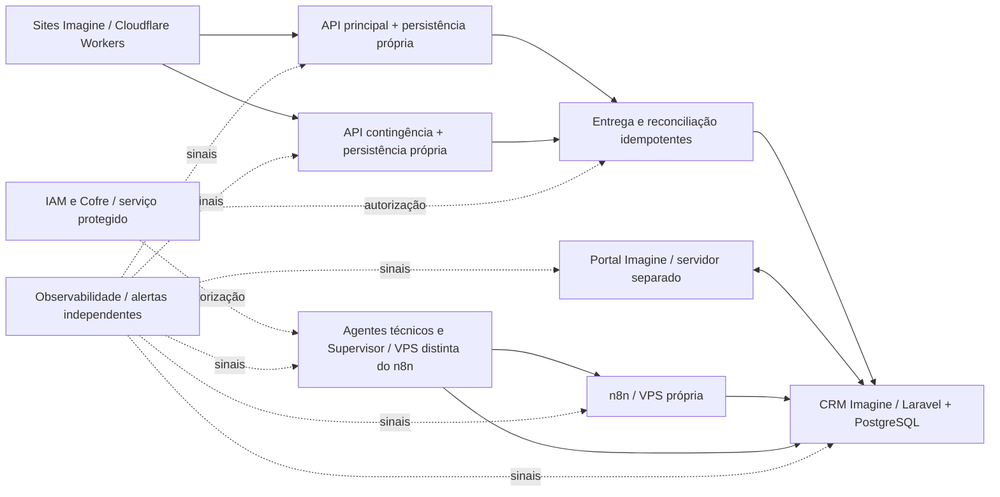

# P0-ARQ-01 — Instrumento de fechamento da topologia e dos limites de infraestrutura

**Data:** 2026-11-03. **Status atualizado:** **APROVADA COMO INSTRUMENTO DOCUMENTAL DE FECHAMENTO**, conforme [CRM-DEC específica](CRM-DEC-aprovacao-P0-ARQ-01-instrumento.md). **ARQ-01 permanece P0 PARCIAL**, sem topologia física, fornecedor, custos ou execução homologados. O [inventário F01](P0-ARQ01-F01-inventario-factual-ativos-e-servicos.md) está **em minuta de conferência, ainda não homologado**.
**Objetivo operacional do planejamento:** **avançar para a decisão efetiva** de ARQ-01, que continua **P0 PARCIAL** no [IN-168](IN-168-matriz-pendencias-fechamento-arquitetura.md), depois de [CRM-REV-09 aceita como base](CRM-DEC-aprovacao-REV-09-base.md).
**Regra:** este instrumento documenta topologia lógica já aprovada, decisões que faltam e critérios de evidência. **Não fecha ARQ-01 por si só** e não aprova fornecedor, dimensionamento, produto ou despesa; nada é provisionado.

## 1. Premissas já aprovadas, que não devem ser reabertas automaticamente

- **Portal e CRM Imagine** executam em **servidores/ambientes próprios, separados**, com integrações autenticadas e bancos isolados. Falha do painel Portal não pode impedir o CRM ou o ingresso durável de leads.
- **Opção B dos agentes técnicos aprovada:** servidor/VPS próprio para **sete agentes técnicos, Supervisor e orquestrador técnico**, separado do host/VPS do **n8n**. O número de agentes é **lógico** e não impõe um servidor por agente.
- **Sites Onepage/Landing Pages** hospedados em **Cloudflare Workers Static Assets**, com GitHub e publicador/agentes autorizados, **sem WHM/cPanel na hospedagem padrão** e **sem DB de leads nos sites**.
- **APIs de leads principal e contingência** devem sobreviver a falhas independentes: API contingência **em outro servidor**, com **fila/persistência durável própria**; outro provedor é **preferência**, não seleção contratada. Sucesso ao visitante só após prova de persistência numa das rotas.
- **Central de Observabilidade** e **sinais de alerta independentes da IA/Supervisor/UI**, identidades de serviço e credenciais no cofre, ações técnicas N1/N2/N3 autorizadas, uma aprovação humana específica quando exigida — **nunca segunda aprovação obrigatória sem decisão**.
- Os conceitos de RPO/RTO, recuperação e backup de cada serviço **não** significam zero indisponibilidade/perda. A definição de números finais, custos e provas de validação permanece aberta.

## 2. Domínios de serviço e fronteiras físicas/lógicas

| ID | Domínio lógico | Separação/regra já decidida | Fato físico/custo que falta confirmar |
|---|---|---|---|
| T01 | Sites públicos Onepage/Landing | Cloudflare Workers Static Assets; GitHub conserva código/versões; sem DB próprio de leads | Aprovado — IN-096; não WHM/cPanel | Configuração final por site, domínio/SSL e custos |
| T02 | CRM Imagine SaaS | Servidor/ambiente separado do Portal, backend Laravel/PostgreSQL multiempresa, RLS e aplicação | Aprovado — ARQ-01 e CRM-REV01 | VPS/provedor/DB/redes, capacidade, backups, contingência |
| T03 | Portal Imagine (cliente/admin) | Ambiente servidor próprio separado do CRM; consulta/gestão, contratação/benefícios, não recebe leads como dependência única | Aprovado — ARQ-01 | Stack/ambientes, SSO/integrações, custos e disponibilidade |
| T04 | API principal de formulários | Serviço de recepção independente do painel Portal; grava duravelmente antes de confirmar aceitação | Aprovado — IN-124 | Host/provedor, persistência, autoscaling/controle de carga |
| T05 | API de contingência | Outro servidor independente da API principal; persistência e fila duráveis próprias; outro provedor é preferência condicionada a análise | Aprovado — IN-124 | Provedor/host, mecanismo de comutação e riscos DNS/shared control plane |
| T06 | Filas e processadores de entrega | Consumidores das duas persistências duráveis, entrega idempotente e confirmação CRM; separação entre recebido e entregue | Aprovado funcionalmente — IN-124/127/148/149 | Alocação física, reconciliador, supervisão, custo, contrato ARQ-02 |
| T07 | n8n e workflow operacional | VPS exclusiva de n8n/orquestração de workflows já prevista; agentes técnicos não compartilham seu host | Aprovado — Opção B IN-168 | Inventário físico real, versão/capacidade, PostgreSQL/workflows/HA |
| T08 | Agentes técnicos e Supervisor | VPS/servidor independente do host n8n, com autorizador e orquestrador técnico de privilégios limitados | Aprovado — Opção B/IN-167 | Dimensionamento, cofre/credenciais, disponibilidade, playbooks e consumo |
| T09 | Cofre de segredos e IAM | Segredos protegidos e identidade por serviço/tenant/ambiente; autorizador independente do texto/IA | Aprovado como capacidade — IN-151/166 | Produto/host/replicação e autorização SEG-01/SEG-02 |
| T10 | Central de Observabilidade/Incidentes | Coleta saúde CRM, Portal, APIs, filas, n8n e agentes; **alerta por caminho independente** de IA/painel/Supervisor | Aprovado — IN-159/160/161 | Componentes e canal externos, coleta/retention/custos ARQ-03/OBS-01 |
| T11 | Backups, PITR e anexos | Dados CRM isolados, objetos privados e retenções; backup Sites não compartilha política com CRM | Aprovado funcionalmente — LEG06/IN-118/IN-143 | Infra de cópia/restauração, RTO/RPO físico, provedor/custo, antimalware |
| T12 | GitHub/CI/CD e Central de Aprovações | Versionamento; liberação para produção rastreável/autorizada; riscos N1/N2/N3 e aprovação humana única quando exigida | Aprovado funcionalmente — LEG06/IN-137 | Pipeline, ambientes, papéis técnicos/segredos, versionamento do artefato |

**Não são 12 novos servidores obrigatórios.** Alguns domínios podem usar serviços gerenciados, processos/containers separados ou infraestrutura compartilhada **somente quando isso não violar** isolamento já decidido, independência real das duas APIs de leads, regras de credencial, risco e disponibilidade. A ligação física final será proposta/validada após inventário de ativos e custos. Não inferir número de VPS pela quantidade de nós da matriz.

## 3. Relações e confirmação de responsabilidade

| ID | Relação | Contrato funcional | Regra negativa / falha |
|---|---|---|---|
| E01 | Site → API principal OU API de contingência | Captação pública sem DB no site; fallback somente em falha válida | Persistência durável confirmada numa rota antes de indicar sucesso; se ambas falham, não confirmar |
| E02 | APIs → suas próprias persistências/fila | Cada rota precisa sobreviver à indisponibilidade da outra | Não compartilhar banco, fila, proxy, cofre ou credencial como dependência única sem demonstrar contingência |
| E03 | Filas → CRM | Processamento idempotente; tenant de destino autorizado, contrato/versionamento | HTTP 202 não prova criação do lead; CRM confirma o registro oficial |
| E04 | Portal ↔ CRM | Contratação, benefício Básico/admin, consulta e vinculação via API autenticada | Falha do Portal não bloqueia atendimento normal CRM nem captação durável |
| E05 | n8n ↔ APIs/CRM/Portal | Workflows tipados e autorizados, sem acesso direto trans-tenant | Sucesso do workflow não é resultado financeiro/comercial/CRM |
| E06 | Agentes ↔ n8n/serviços | Ferramentas tipadas e homologadas, credenciais escopadas; autonomia N1/N2/N3 | Sem root amplo ou credenciais globais por padrão; ações críticas com aprovação específica |
| E07 | Sistemas → observabilidade | Métricas/traces/logs minimizados e correlacionados | Alertas devem continuar se IA, Supervisor, painel ou um subsistema falharem |
| E08 | Sistemas → cofre/IAM | Segredos/identidades por serviço/ambiente/cliente | Falha do cofre não pode implicitamente autorizar ação; políticas de disponibilidade e fallback a definir |
| E09 | CRM → objetos privados/backups | Autorização sempre no backend/tenant; replicação e restauração controladas | URL assinada/objeto S3 não substitui verificação de acesso, quota ou retenção |
| E10 | Pipelines → serviços publicados | Deploy homologado, aceite humano previsto, rollback protegido | Pipeline técnico não cria aprovação de negócio, não publica em produção sem alçada |

## 4. Mapa lógico ilustrativo — NÃO diagrama de implantação aprovado

As setas **não** significam acesso administrativo irrestrito, identidade global nem protocolo/endpoint já definido. O diagrama apenas ilustra fronteiras; os domínios IAM/Observabilidade podem exigir redundância própria ainda não escolhida. Serviços de armazenamento/backup/CI-CD foram omitidos do desenho para facilitar leitura, mas estão no inventário T09–T12.

## 5. Plano de fechamento ARQ-01 — evidências e decisões faltantes

| ID | O que falta decidir ou levantar | Fonte/dependência | Condição para considerar coberto |
|---|---|---|---|
| ARQ01-F01 | Inventário factual dos ativos atuais | Host/provedor, localização, CPU, RAM, disco, SO, versão, DNS, IPs, banco, contratos/custo, aplicações e responsáveis por recurso | IN-153; ARQ-01 | Dados reais não verificados neste documento; não declarar servidores existentes por memória |
| ARQ01-F02 | Topologia final por domínio de falha | Atribuir cada T01..T12 a serviço/VM/host e zona de falha; redundâncias/compartilhamentos permitidos | IN-124; ARQ-01 | Não converter domínios lógicos em 12 VPS obrigatórias nem reaproveitar n8n para agentes |
| ARQ01-F03 | Infraestrutura e custos CRM/Portal | Provedor/contrato, plano de banco, armazenamento, tráfego, backup, homologação e despesas do Portal | ARQ-01; CRM-REV02 | Separação dos servidores é decisão; escolha física/custo não |
| ARQ01-F04 | Infraestrutura dos agentes Opção B | Sizing por CPU/RAM/IOPS/concorrência e comportamento do provedor/modelos, custos e atualização de segurança | IN-168 ARQ-01; IN-142 | Opção B decidida, tamanho/fornecedor não |
| ARQ01-F05 | Duas APIs com falha independente | Escolher hosts, armazenamento durável próprio, roteamento/failover, dependências DNS/cert/identidade, custos | IN-124; ARQ-02 | Contingência tem de resistir à falha da principal; outro provedor desejável, não obrigatório sem aprovação |
| ARQ01-F06 | Filas e confirmadores do CRM | Ligar filas a processadores e ao dono oficial; idempotência, reconciliação, divergência, prazo 18d | IN-124/127/149; ARQ-02 | Contrato detalhado ARQ-02/INT-P0 ainda aberto |
| ARQ01-F07 | Segurança e cofre | Trust zones, canais TLS, credenciais, IAM/RLS, segregação produção/homologação, rotação e revogação | SEG-01/SEG-02; CRM-REV01 | Provedor de segredos e matriz efetiva ainda abertos |
| ARQ01-F08 | Monitor e alertador independente | Locais de coleta, último estado conhecido, fallback de alerta, escalonamento, proteção contra falha comum | ARQ-03; IN-159/160 | Não usar a própria IA/Supervisor/UI como única origem de alerta |
| ARQ01-F09 | Backups e recuperação | Desenhar PITR/objetos/logs por serviço, alvo RPO/RTO com custo e restore seguro | IN-143/144; CON-01 | RPO 15 min/RTO 4h são referências iniciais CRM, não promessa final |
| ARQ01-F10 | Dimensionamento de tráfego e custos | Cenários de escala de sites/tenants, submissões, anexos, agentes, workflows, storage, logs, falhas | IN-142/153; COMERCIAL | Sem preço/provedor/rate observado, não publicar valores como fato |
| ARQ01-F11 | Integração e governança mudanças | Quem aprova cada mudança, versão, dependências, rollback, teste futuro e auditoria | IN-137/154/155; LEG06 | Nunca dupla aprovação humana mandatória para o mesmo ato quando uma única já foi aprovada |
| ARQ01-F12 | Conclusão documental ARQ-01 | Mapa final e fontes, decisões explícitas de custos/falhas, evidências do inventário, critérios e versão GitHub | IN-168; CRM-STATUS | Somente após decisão/evidência registrar P0 como decidido/especificado; este documento não o fecha |

**Sequência recomendada que evita retrabalho:** (1) validar inventário factual e domínios de falha; (2) mapear alocação física e capacidade/custos de CRM, Portal, n8n, agentes e APIs; (3) cotejar independência real de filas, DNS, segredos e alertas; (4) conferir RTO/RPO, backups, segurança e contratos de interface; (5) submeter **opções físicas com valores e riscos verificados** para a decisão do responsável; (6) apenas depois reclassificar ARQ-01 com evidências e seguir para ARQ-02/SEG-01.

**O que já está decidido não necessita nova votação:** separação Portal×CRM, Opção B agentes×n8n, Cloudflare Workers para Sites, duas APIs com persistência independente, alertas independentes. **O que necessita aceite futuro expresso:** fornecedores, recursos/custos, pontos de falha compartilhados, implantação operacional, cobertura de continuidade e metas de recuperação.

## 6. Cenários futuros de aceitação documental/técnica — 0 testes executados

| ID | Falha ou conflito | Evidência futura necessária |
|---|---|---|
| ARQ01-C01 | Perda do servidor da API principal | API de contingência mantém persistência durável e o site não sinaliza falso sucesso |
| ARQ01-C02 | Indisponibilidade do painel Portal | CRM e APIs de leads continuam operações essenciais independentes |
| ARQ01-C03 | Falha n8n | Agentes em VPS própria não caem necessariamente junto; fila durável não perde lead |
| ARQ01-C04 | Falha da VPS de agentes | n8n/CRM/painel/APIs não dependem deles para aceitar duravelmente leads |
| ARQ01-C05 | Falha no provedor DNS/certificado comum | Risco comum explicitado e contingência projetada; não prometer independência inexistente |
| ARQ01-C06 | Cofre indisponível | Bloquear ações não autorizadas, registrar contingência segura sem credencial exposta |
| ARQ01-C07 | Queda de observabilidade/Supervisor | Caminho independente alerta sem afirmar saúde fictícia |
| ARQ01-C08 | Leads com mesmo envio enviados às duas APIs | Reconciliar para registro lógico único, sem duas pessoas mescladas automaticamente |
| ARQ01-C09 | Banco CRM indisponível | Filas duráveis preservam payload elegível; front-end só indica recebimento quando realmente durável |
| ARQ01-C10 | Restauração de backup CRM ou anexos | Verificar tenant e não reproduzir segredos/contas ativas em homologação |

Não são testes executados, não adicionam gates globais novos e não exigem produção ou ambiente provisionado **antes do começo do desenvolvimento**. O contrato de aceitação e a topologia devem ser concluídos documentalmente; testes reais virão na fase de homologação autorizada.

## 7. O que uma aprovação deste instrumento significaria

**Aceite registrado:** a [P0-ARQ-01 foi aprovada como instrumento documental](CRM-DEC-aprovacao-P0-ARQ-01-instrumento.md) de topologia lógica e evidências **sem marcar ARQ-01 como resolvida**. O [ARQ01-F01 — inventário preliminar](P0-ARQ01-F01-inventario-factual-ativos-e-servicos.md) foi **preparado como levantamento documental não homologado**, separando informações históricas e dados confirmados. A escolha física/orçamentária ainda exige fontes atualizadas e aprovação específica.

**ARQ-01 permanece P0 parcial**, e **ARQ-02, ARQ-03, SEG-01, SEG-02, AGT-01**, CORE-P0, INT-P0 e G01–G06 continuam abertos. **Nenhuma implementação foi autorizada.**

**Fontes:** [ARQ-01 comparativo aprovado parcialmente](ARQ-01-comparativo-infraestrutura-agentes-tecnicos.md), [IN-124 duas APIs](IN-124-integracao-inteligente-formularios-leads.md), [IN-153 inventário](IN-153-inventario-inteligente-infraestrutura-dependencias.md), [IN-167 agentes técnicos](IN-167-consolidacao-arquitetura-agentes-tecnicos.md), [IN-168 bloqueios](IN-168-matriz-pendencias-fechamento-arquitetura.md), [CRM-REV-09](CRM-REV-09-infraestrutura-seguranca-auditoria-operacoes-centrais.md), [IN-143 continuidade](IN-143-continuidade-operacional-recuperacao-inteligente-desastres.md) e [P0-GATE INT](integracoes/P0-GATE-painel-fechamento-rastreabilidade-dependencias.md).

## Atualização 03/11/2026 — Governança central de IA de todos os produtos Imagine

Aprovado o [registro de arquitetura transversal](CRM-DEC-arquitetura-central-agentes-n8n-ecossistema-imagine-2026-11-03.md): **n8n em sua VPS dedicada, separado fisicamente/virtualmente da VPS exclusiva dos sete agentes técnicos, Supervisor e orquestrador técnico**. A governança pode ser central entre CRM, Portal, Sites, Performance AI e futura Universidade Imagine, mas **não pressupõe hospedar todos os agentes funcionais e motores de IA na VPS de agentes técnicos**. Cada produto mantém autorização, dados, contratos, ciclo de vida e execução crítica próprias; o Performance AI mantém seu motor de processamento independente. APIs principal/contingência de leads e alertas externos permanecem independentes do n8n e agentes. **Dois servidores compartilhados não representam a infraestrutura total do ecossistema.** Decisão documental aprovada, com dimensionamento, topologia física, segurança, custos e ARQ-01 P0 ainda pendentes. Sem compras ou programação.

## Atualização de arquitetura 04/11/2026 — Motor próprio do CRM e fronteira de licença n8n

[Decisão aprovada](CRM-DEC-motor-proprio-automacoes-crm-n8n-interno-2026-11-04.md): automações de clientes do CRM são executadas pelo **motor próprio do CRM**, sem depender de n8n como executor/editor de workflows de clientes. A VPS n8n conserva apenas processos internos Imagine **compatíveis com a licença efetivamente validada**. Essa escolha complementa, sem revogar, a separação n8n/agentes técnicos, Portal/CRM, duas APIs independentes de captação e canais de alerta externos. **A validação formal da licença é gate pré-implantação**, sem liberação de desenvolvimento ou fechamento de ARQ-01.
